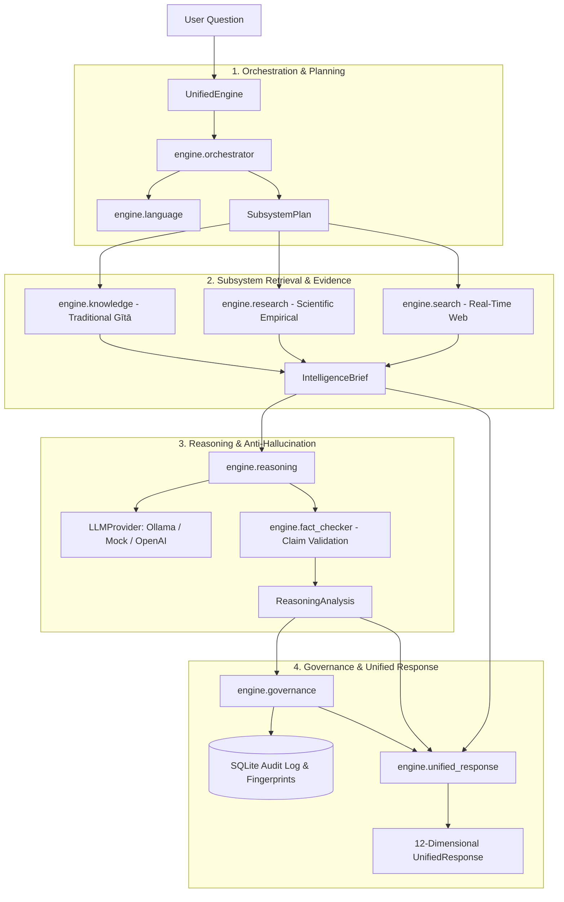

# ANTARĀ — Layer 1 Architecture Specification
## Core Intelligence & Advanced Reasoning

---

## 1. Purpose and Scope
Layer 1 is the foundational execution core of ANTARĀ. It provides the central intelligence and reasoning pipeline, coordinating:
- Traditional primary source knowledge retrieval (Bhagavad Gītā).
- Modern empirical and scientific research retrieval.
- Secure, real-time live internet search and conflict analysis.
- Deterministic anti-hallucination fact checking.
- Multi-provider AI reasoning (local Ollama, deterministic mocks, optional OpenAI).
- Cryptographic human-in-the-loop governance and publishing controls.
- Telugu-native and English foundational language analysis.

Layer 1 operates under a strict **local-first** mandate, enabling complete offline functionality with zero external credentials.

---

## 2. Component Architecture

---

## 3. Module Responsibilities

| Module | Primary Responsibility |
|---|---|
| `engine/unified_engine.py` | Top-level coordinator managing end-to-end question processing, routing, and lifecycle states. |
| `engine/orchestrator.py` | Input validation, subsystem classification, objective generation, and `IntelligenceBrief` assembly. |
| `engine/language.py` | Telugu Unicode script detection, language classification, Romanized Telugu awareness, dialect registry. |
| `engine/nlp.py` | Layer 1 NLP foundations: normalization, intent detection, code-switching, entities, semantic retrieval, evaluation. |
| `engine/knowledge.py` | SQLite verse storage, chapter bounds, cryptographic content hashing, and human verification trails. |
| `engine/retrieval.py` | Knowledge retrieval bridge with defense-in-depth verification and tamper rejection. |
| `engine/research.py` | Peer-reviewed study storage, DOI normalization, 4-tier evidence classification, and review workflow. |
| `engine/search.py` | Live web search abstraction, SSRF mitigation, robots.txt compliance, bounded LRU caching, conflict analysis. |
| `engine/fact_checker.py` | Deterministic claim extraction, Sanskrit quote matching, source reference validation, and hallucination score. |
| `engine/llm_provider.py` | Abstract provider interface (`LLMProvider`), normalized `LLMResponse`, and deterministic `MockLLMProvider`. |
| `engine/ollama_provider.py` | Local Ollama HTTP driver using `GET /api/tags` and `POST /api/generate` with model verification. |
| `engine/openai_provider.py` | Optional cloud provider using OpenAI SDK with structured JSON mode and error translation. |
| `engine/reasoning.py` | Comparative cross-domain reasoning, claim generation, fact-check auditing, and 16-card synthesis. |
| `engine/governance.py` | 9-state report lifecycle, SHA-256 fingerprint approval binding, tamper invalidation, publishing pipeline. |
| `engine/unified_response.py` | Consolidated 12-dimensional output contract with language metadata and provenance. |

---

## 4. Main Data Flows

1. **Inquiry Ingestion & Routing**:
   - `UnifiedEngine.process(question)` receives raw query string.
   - `engine.orchestrator.validate_question` normalizes whitespace, verifies length (<= 500 chars), and enforces string types.
   - `engine.language` detects script, identifies whether Romanized Telugu or English is present, and detects dialect stubs.
   - `classify_subsystems` evaluates keyword presence and returns a deterministic `SubsystemPlan`.

2. **Evidence Harvesting**:
   - Traditional Knowledge: `engine.retrieval.retrieve_knowledge` fetches verified verses from `KnowledgeBase`, excluding unreviewed or tampered rows.
   - Scientific Research: `engine.research.ResearchManager` queries approved studies by topic, extracting supporting and contradicting findings.
   - Live Search: If indicated, `engine.search.SearchManager` queries configured providers, sanitizes snippets, checks robots.txt, and detects semantic conflicts across sources.
   - `create_brief` bundles these contexts into an immutable `IntelligenceBrief`.

3. **Reasoning Synthesis & Validation**:
   - `ReasoningEngine.analyze_brief` constructs a structured context via `ContextBuilder`.
   - `LLMProvider` generates structured analysis with strict JSON mode.
   - `FactChecker.validate_claims` deterministically verifies every asserted claim and quote against primary database records.
   - If any claim fails validation or is contradicted by verified evidence, the analysis status is set to `validation_failed`.

4. **Human Governance & Publishing**:
   - `GovernanceEngine.register_report` creates a `GovernanceRecord` with status `pending_review` (or `validation_failed`).
   - Human reviewers approve, reject, or request revision via `review_report(report_id, ...)`, requiring >= 20 characters of substantive rationale.
   - When approved, a SHA-256 fingerprint of the exact content is permanently recorded in the append-only audit trail.
   - If content is altered post-approval, the fingerprint mismatches and publication is strictly blocked.
   - Publication occurs only after explicit human authorization via `authorize_publication`.

5. **12-Dimensional Response Construction**:
   - `build_unified_response` transforms brief, validated analysis, and governance records into a normalized `UnifiedResponse`.

---

## 5. Local Ollama Integration Architecture

- **Service Health Check**: `_verify_service` executes `GET /api/tags` to ensure the local Ollama server is responding.
- **Model Discovery & Verification**: `_verify_model` checks that the configured model (default: `qwen2.5:1.5b`) is installed in the cached tags list. If missing, it raises `OllamaModelNotFoundError` with manual pull instructions.
- **Inference Execution**: `generate` sends `POST /api/generate` with stream=False and optional JSON system instruction.
- **Error Mapping**: Network timeouts raise `LLMTimeoutError`; refusal patterns raise `LLMRefusalError`; incomplete generations raise `LLMIncompleteResponseError`.
- **Zero Cloud Leakage**: When configured for Ollama or Mock, no external HTTP requests are made.

---

## 6. Language Foundations (Telugu-First)

- **Script vs Language**:
  - `detect_script`: Distinguishes Telugu Unicode (`U+0C00–U+0C7F`), Latin alphabet (`[A-Za-z]`), mixed scripts, and non-alphabetic input.
  - `detect_language`: Categorizes language without assuming Latin script is English.
- **Romanized Telugu Detection**:
  - Words like *naaku*, *emi*, *chaala* in Latin script are classified as `mixed` rather than `english`.
- **Dialect Registry**:
  - Extensible pattern registry supporting classical (*దుర్గాపురాణ*), vyavaharika (*చెప్పుద్దాం*), and romanized registers.
  - Unicode-aware boundaries ensure conjuncts and viramas do not trigger false regex misses.

---

## 7. Security Boundaries & Safeguards

- **SSRF Defense**: `engine.search.is_prohibited_ip` parses all retrieved URLs against loopback (`127.0.0.0/8`), private networks (`10.0.0.0/8`, `172.16.0.0/12`, `192.168.0.0/16`), and link-local ranges, blocking connections immediately.
- **Robots.txt Policy**: `RobotsPolicyChecker` checks robots rules before web content extraction.
- **Prompt Injection Defense**: `sanitize_search_snippet` strips script tags, iframe elements, system prompt keywords, and control markers from untrusted web text.
- **Secret Redaction**: Logging configurations and error formatters never output API keys, auth headers, or raw credentials.
- **Database Safety**: All SQLite operations use parameterized queries (`?`) and transaction context managers, preventing SQL injection and database corruption.

---

## 8. Resource Management & Device Profiles

| Target Profile | RAM Budget | Layer 1 Footprint | Strategy |
|---|---|---|---|
| **4 GB RAM (Low / Mobile)** | ~1.5 GB Available | **~48.5 MB RSS** | On-demand provider loading, bounded caches, lazy import of heavy modules. |
| **8 GB RAM (Development)** | ~4.5 GB Available | **~48.5 MB RSS** | Concurrent search workers (max 4), cached SQLite connection pool. |
| **16 GB RAM (High / Server)** | ~10 GB Available | **~48.5 MB RSS** | High-throughput batch reasoning and governance publication. |

- **Storage Optimization**: Core Layer 1 repository occupies **< 1 MB (0.80 MB)** on disk excluding git history and virtual environments, well within the 180 GB total long-term target.
- **Network Optimization**: Offline execution is 100% deterministic; search results are cached in an in-memory bounded LRU cache (100 entries, 1-hour TTL).
- **CPU & Battery**: No persistent idle polling threads or background daemons. Idle components consume zero CPU cycles.

---

## 9. Layer 2 Readiness & Extension Points

Layer 1 provides clean, stable extension hooks for Layer 2:
1. `engine.language`: Hook for neural phonological transliteration and deep syntactic parsers.
2. `engine.knowledge`: Schema foundation ready for universal ontology graph links.
3. `engine.llm_provider`: Interface prepared for multimodal perception providers (vision, audio).
4. `engine.unified_response`: Versioned schema supporting future cross-modal perception fields.
